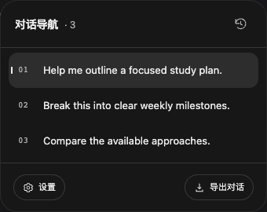
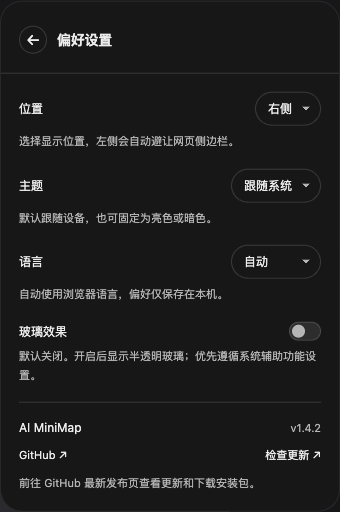

# AI MiniMap

[简体中文](README.md) · [English](README.en.md)

Lightweight conversation navigation and selective export for ChatGPT, Gemini and Claude.

## Features

- Hover to expand a compact minimap; click prompts to jump and highlight messages. AI-only conversations navigate replies instead. The rail grows with message count and hides on empty chats.
- Collect earlier messages through the website's own loading mechanism, with inline progress, cancellation and reading-position restoration.
- Select user prompts or AI replies and export TXT, Markdown or JSON.
- Choose left/right placement, sidebar avoidance, system/light/dark themes, and English or Simplified Chinese. Glass is optional and disabled by default.
- Keyboard navigation, reduced-motion support, contextual help and a link to the latest release.

## Preview

Screenshots use synthetic conversations.

| Navigation | Settings |
| --- | --- |
|  |  |

## Installation

Download packages from [Releases](https://github.com/CaryK753/AI-MiniMap/releases), or run `python3 script/package.py` from the source checkout.

| Browser | Package | Installation |
| --- | --- | --- |
| Chrome / Edge | `conversation-minimap.zip` | Extract, enable Developer mode in the extension manager, and load the folder containing `manifest.json`. |
| Firefox 140+ | `ai-minimap-firefox-unsigned.xpi` | Load temporarily through `about:debugging#/runtime/this-firefox`. Temporary add-ons disappear on restart; persistent installation requires Mozilla signing. |
| Safari 27 | `conversation-minimap.zip` | Extract and add a temporary extension through Safari developer settings. Grant website access. Temporary extensions expire after 24 hours or when Safari quits. |
| Safari native app | `conversation-minimap-safari-app.zip` | Ad-hoc signed for local development, not notarized. See [Safari instructions](docs/SAFARI.md). |

Reload the extension and refresh open chat pages after updating.

## Usage

1. Open a conversation and hover over the rail; click the rail to keep navigation open.
2. Click a prompt or reply to jump to it.
3. Use the history icon to collect earlier messages; click again to stop. Hover for help.
4. Open Export, filter roles, select messages and download the desired format.
5. Open Settings to adjust appearance, position and language. Check for updates opens the latest GitHub release.

Tab moves focus, arrow keys move between navigation items, Enter activates, and Esc closes the panel or stops collection. Scrolling the page during collection also stops it.

## Compatibility and limitations

ChatGPT supports ordinary/project chats, scheduled AI-only updates and role-marked Work/Codex conversations. Legacy Codex task layouts have fixture coverage but have not been verified in a live account. Gemini supports virtual history lists; Claude supports chat/share pages and recycled message nodes.

Collection depends on messages exposed by the page. Reaching both page ends does not guarantee complete server history. Each pass lasts up to approximately three minutes and can be repeated. Website layout changes may require adapter updates.

Exports exclude attachment files, hidden branches and separate tool output. Images become references or placeholders; Markdown is reconstructed from page structure. Webpage glass uses CSS; native Liquid Glass applies only to the supporting macOS containing app.

## Privacy

No conversation uploads, analytics, AI API calls or private conversation APIs. The `storage` permission saves appearance, position and language preferences only. Conversation caches stay in tab memory and clear on refresh or conversation change. Export files contain selected messages and the source URL. History collection triggers normal website requests; GitHub links open only when clicked.

## Development

The extension uses plain JavaScript and Manifest V3, without runtime dependencies. Tests require Node.js 20+, Python 3 and Playwright. Native Safari builds require macOS and compatible Xcode.

```sh
npm ci
npx playwright install chromium firefox webkit
npm run check
npm run test:release
npm run test:chromium
npm run test:firefox
npm run test:webkit
npm run package
```

Source lives in `extension/`, browser overrides in `browsers/`, native projects in `safari/`, helpers in `script/`, and regression fixtures in `tests/`.

See [testing](docs/TESTING.md) and [release instructions](docs/RELEASING.md). Pushes and pull requests run validation, browser regressions and native Safari builds. Matching `vX.Y.Z` tags trigger packaging and GitHub Releases with SHA-256 checksums.

## Contributing

Report problems through [Issues](https://github.com/CaryK753/AI-MiniMap/issues), including browser/extension versions, the affected platform and reproduction steps. Remove private information from screenshots and logs.

## License

[MIT License](LICENSE).
