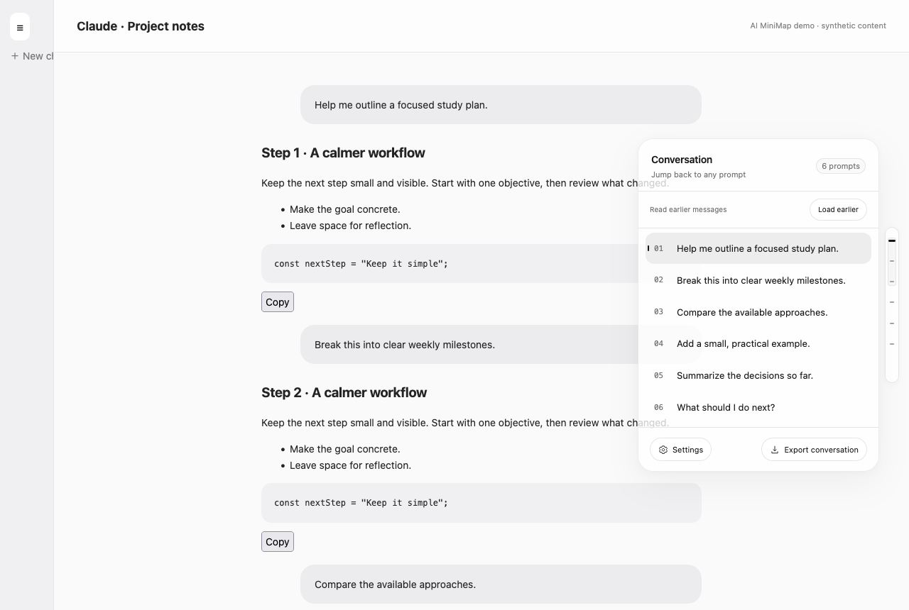
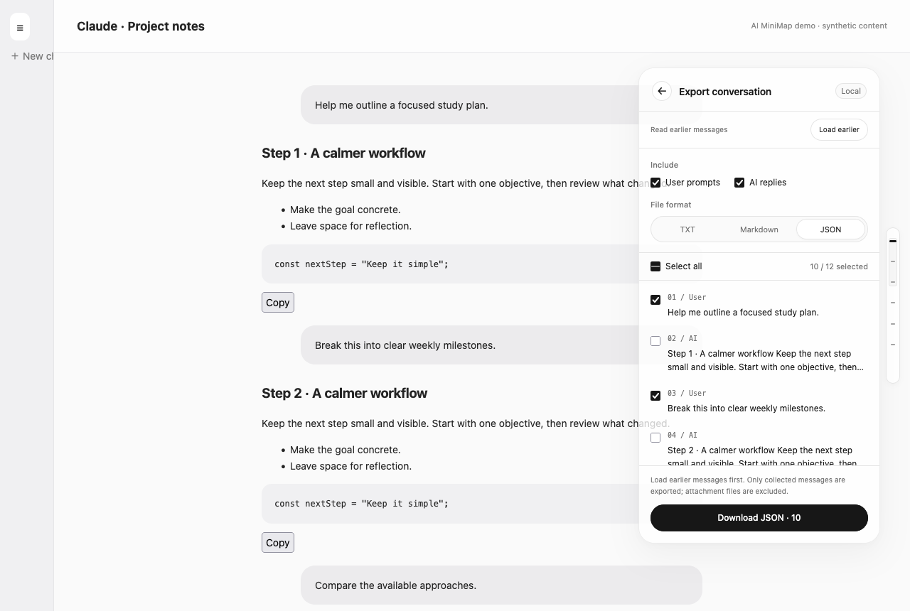
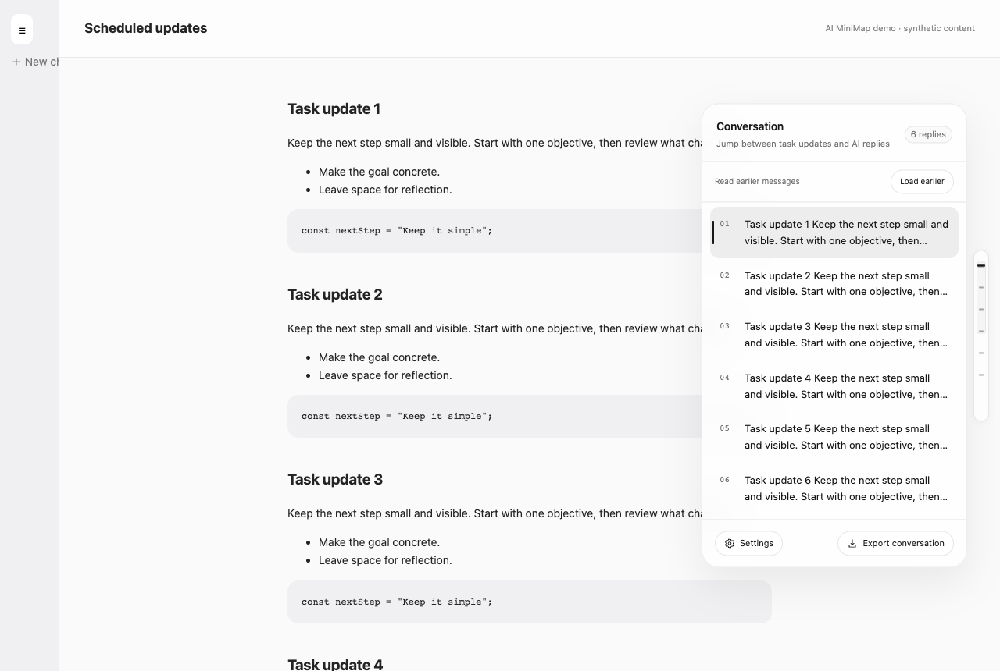
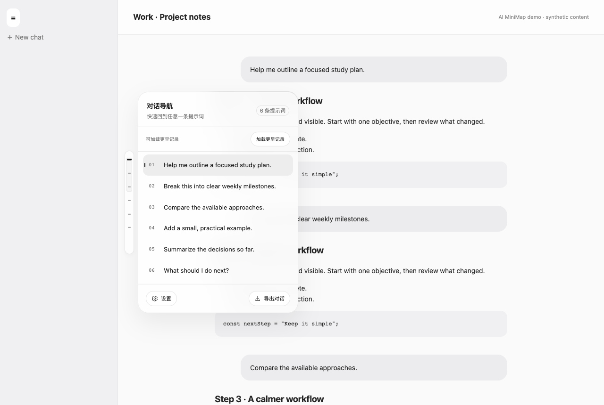
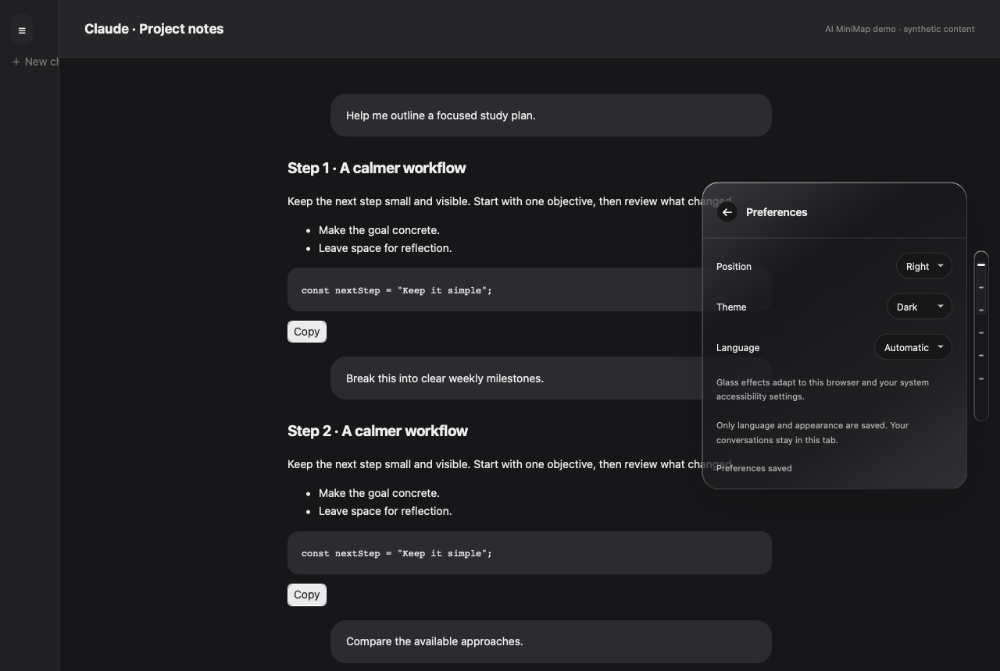
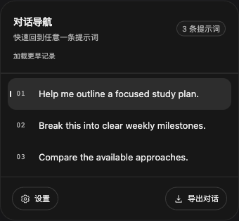
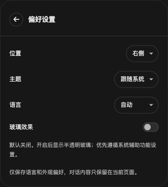

# AI MiniMap

[English](README.md) · [简体中文](README.zh-CN.md)

A lightweight, local-first conversation navigator for **ChatGPT, Gemini and Claude**. Hover to open the capsule, jump between prompts, collect earlier messages, and export the parts you need.

**Version 1.4.1** · Author: **wwj** · [MIT License](LICENSE)

## What it does

- **Hover navigation:** a compact rail expands into a prompt list; click a prompt to jump and highlight it.
- **Scheduled / AI-only conversations:** when there are no user prompts, the list navigates AI replies and task updates instead.
- **ChatGPT Work / Codex:** recognizes conversation role markers and the older Codex bubble layout. Tool-output panels are excluded from message extraction.
- **Earlier history:** scrolls through the website's own loading mechanism, accumulates messages in memory, and handles unmounted or recycled message nodes. A progress indicator and Stop button remain available.
- **Selective export:** filter user prompts / AI replies, select individual messages, then download **TXT, Markdown or JSON**.
- **Settings:** English / Simplified Chinese, automatic language detection, System / Light / Dark themes, and **left / right positioning**. Preferences persist locally.
- **Sidebar-aware placement:** on the left, follows the website sidebar as it expands or collapses. Temporarily hides when a narrow-screen sidebar leaves insufficient space.
- **Quiet when empty:** no minibar on a blank new conversation. The first message brings it back automatically.
- **Accessible motion:** keyboard navigation, visible focus, reduced-motion support, and opaque fallback for increased contrast / reduced transparency.

## Screenshots

All screenshots below use **synthetic local conversations**, not private account content. Browser engines are real; the surrounding chat layouts are deterministic fixtures.

### Prompt navigation in Firefox



### Select and export messages



### Scheduled task updates



### Left placement beside an expanded sidebar



### Language, theme and position settings



## Install

Download the source from this repository, or build browser packages with:

```sh
python3 script/package.py
```

This creates the following folders and archives in `outputs/`:

| Browser | Package / source | How to load |
| --- | --- | --- |
| Chrome / Edge | `conversation-minimap.zip` or `extension/` | Open the extension manager, enable Developer mode, choose **Load unpacked**, then select the folder containing `manifest.json`. |
| Firefox **140+** | `ai-minimap-firefox.zip` / `ai-minimap-firefox-unsigned.xpi` | Open `about:debugging#/runtime/this-firefox`, choose **Load Temporary Add-on**, select the Firefox manifest or unsigned XPI. |
| Safari **27** | `conversation-minimap.zip` or `extension/` | Safari Settings → Developer → **Add Temporary Extension**, then enable the extension and grant website access. |
| Safari native development | `conversation-minimap-safari-project.zip` or `safari/` | See [Safari build and signing instructions](docs/SAFARI.md). |

Firefox temporary add-ons are removed when Firefox restarts. Persistent Firefox distribution requires Mozilla signing; this project does **not** include an AMO-signed release. Safari temporary extensions expire after 24 hours or when Safari quits. Safari's unsigned-extension system confirmation must be completed by you.

After updating, **reload the extension and refresh the chat webpage**. Grant access to `chatgpt.com`, the legacy `chat.openai.com`, `gemini.google.com`, and `claude.ai` as needed.

## Use

1. Open a conversation with at least one message.
2. Hover over the right rail, or click it to keep the panel open.
3. Click any prompt to jump. In AI-only chats, click a reply / task update.
4. Choose **Settings** for language, theme and left / right position.
5. For a long conversation, choose **Load earlier** and wait for the collected count to settle.
6. Choose **Export conversation**, filter roles, select messages and a file format, then download.

**Keyboard:** Tab enters controls; Up / Down moves between navigation items; Enter activates; Esc closes the panel or stops history collection. Scrolling the webpage while collection is running stops the sweep.

## Coverage and limits

| Website / layout | Implementation and verification |
| --- | --- |
| ChatGPT chat / project chats | Supports current search-unit markers and older author-role attributes. |
| ChatGPT scheduled conversations | AI-only reply navigation; inspected against a real signed-in scheduled conversation. |
| ChatGPT Work / Codex | Role-marked conversations plus guarded legacy Codex bubble fallback. Layout fixtures tested; separate legacy Codex task pages were not live-account verified. |
| Gemini | User-query / model-response parsing, hidden sender-label removal, paginated history collection. |
| Claude chat / share | Current `user-message`, `assistant-message`, `data-turn-key`, and reply-text hooks inspected in a signed-in account. Legacy response-class fallback retained. Login-page demonstration messages are ignored. |

Only messages supplied by the webpage can be collected. A website may load history gradually, recycle nodes or stop providing older messages. **“Reached both page ends” is not a guarantee of complete server history.** Collection stops after about three minutes per pass; you can run it again.

Conversation caches are in this tab's memory only and clear on refresh / conversation change. Images are exported as references or placeholders; attachment files are not bundled. Markdown is reconstructed from visible webpage structure rather than retrieved as original server Markdown. Hidden branches and separate tool / terminal panels are not exported.

Glass is disabled by default; enable it in Settings. Chromium and Firefox use CSS translucent glass. Safari webpage panels use **WebKit CSS glass**, not native Liquid Glass. The macOS containing app uses **native SwiftUI Liquid Glass on macOS 26+**, with a system-material fallback on older macOS versions.

## Privacy

- No analytics, third-party uploads, AI API calls or private conversation APIs.
- The only extension API permission is **`storage`**, used for language, theme and side preference.
- Conversation text remains in memory until you explicitly download an export. Export files include source URL and original selected content.
- Reading earlier history triggers the website's normal loading requests.
- Firefox's manifest declares `data_collection_permissions.required: ["none"]`; no data is transmitted outside the browser by the extension.

## Develop and test

The extension has **no runtime dependencies or build step**. Browser tests use Node.js and Playwright:

```sh
npm install
npx playwright install chromium firefox webkit
npm run test:chromium
npm run test:firefox
npm run test:webkit
npm run screenshots
npm run package
```

See [test coverage and evidence](docs/TESTING.md) for the difference between live DOM inspection, browser-engine fixture tests and signed-store installation.

```text
extension/       Shared Manifest V3 source
browsers/        Browser-specific manifest overrides
safari/          macOS Safari Web Extension Xcode project
script/          Packaging and native build helpers
tests/           Cross-browser fixtures and regression tests
docs/            Screenshots, Safari instructions and test notes
```

`extension/content/profiles.js` centralizes site-specific hooks. `layout.js` owns sidebar-aware placement; `adapter.js` and `store.js` handle message identity and conversation boundaries.

For macOS native development, run `./script/build_and_run.sh --build-only` or use the Xcode scheme. The default script also launches the app. Local application builds use ad-hoc signing; they are **not notarized distribution builds**.

## Automated releases

See [release instructions](docs/RELEASING.md). Version tags automatically test, package and publish GitHub Releases with checksums.

Current compact navigation and Settings (glass disabled):




