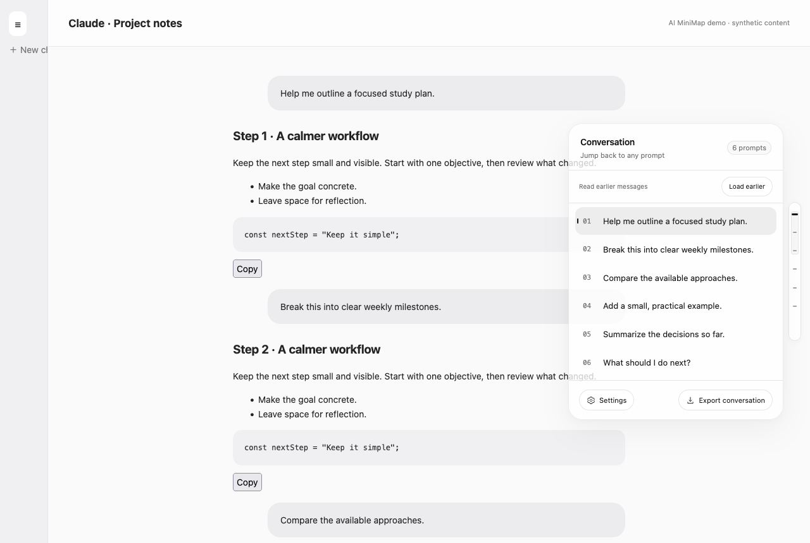
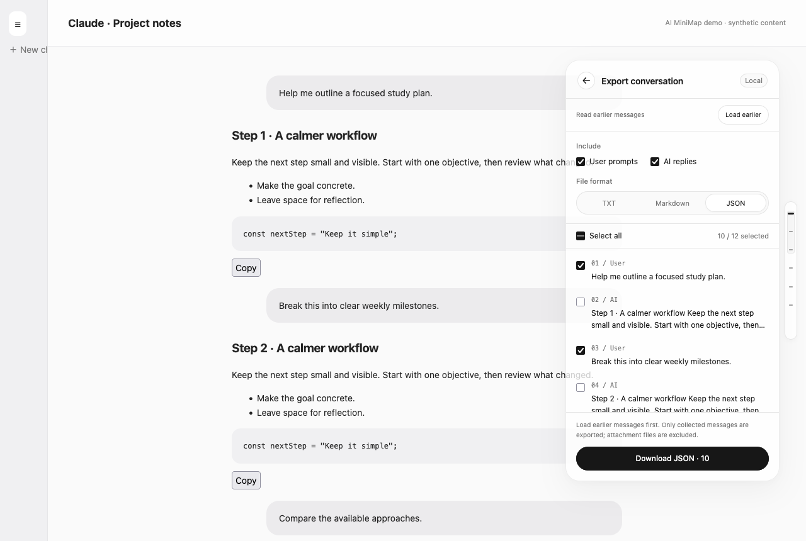
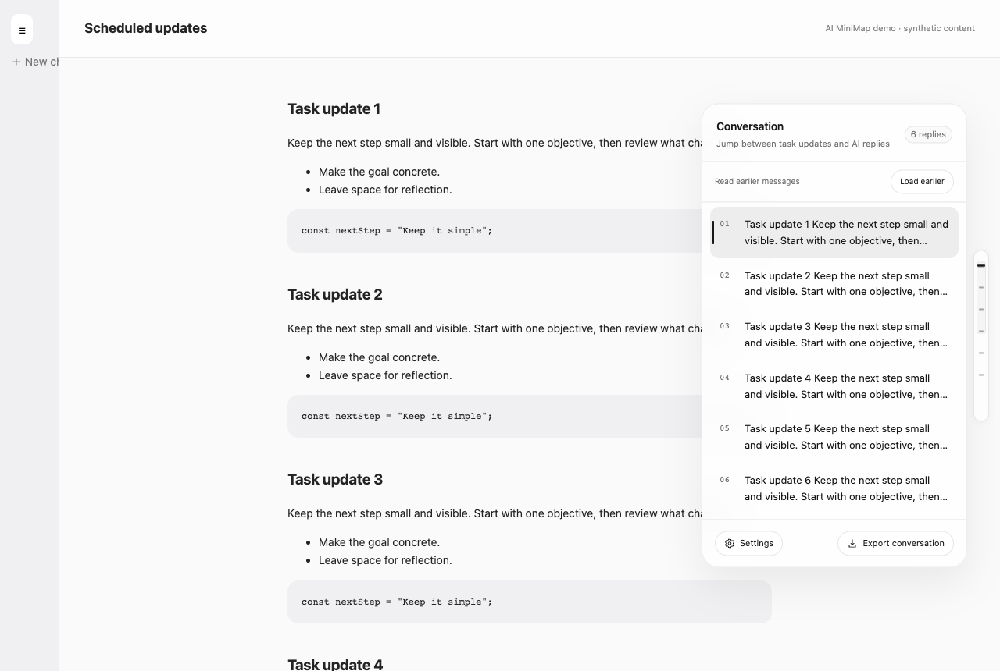
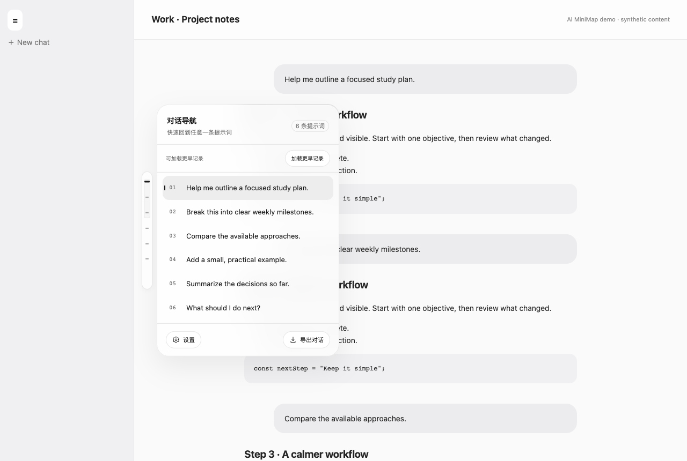
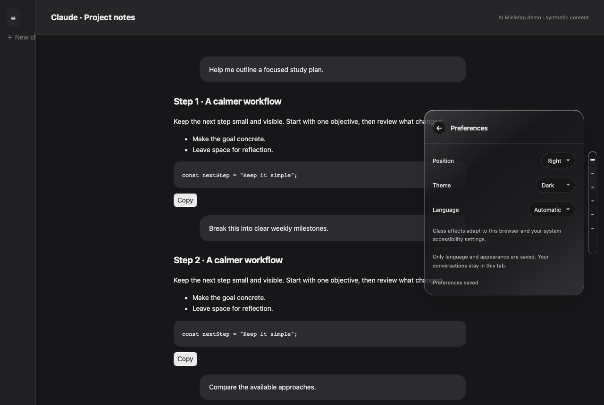

# AI MiniMap

[English](README.md) · [简体中文](README.zh-CN.md)

为 **ChatGPT、Gemini 和 Claude** 提供轻量的对话缩略导航。悬浮展开胶囊面板，点击提示词跳转，读取更早记录，并选择需要的内容导出。

**版本 1.4.0** · 作者：**wwj** · [MIT 许可证](LICENSE)

## 功能

- **悬浮导航**：平时收起成细条，悬浮展开，点击提示词快速跳转并高亮。
- **定时任务 / 纯 AI 会话**：没有用户提示词时，自动按 AI 回复或任务更新导航。
- **ChatGPT Work / Codex**：识别消息角色标记，兼容旧版 Codex 气泡结构，排除独立工具输出。
- **历史采集**：使用网站自己的滚动加载机制，将读到的消息保留在当前页面内存；支持节点被移除或复用的列表，可查看进度、随时停止。
- **选择导出**：筛选用户提示词 / AI 回复、逐条勾选，下载 **TXT、Markdown、JSON**。
- **设置**：中英双语自动选择，可手动切换；跟随系统 / 亮色 / 暗色；**左侧 / 右侧**位置，自动保存偏好。
- **侧边栏避让**：放在左侧时跟随网站侧边栏展开和收起调整位置；窄屏遮罩侧边栏占满空间时暂时隐藏。
- **空白页不打扰**：新对话没有消息时隐藏，出现首条消息后自动恢复。
- **动效与辅助功能**：键盘导航、焦点提示、减少动态效果，以及提高对比度 / 减少透明度时的不透明回退。

## 截图演示

以下截图全部使用**本地合成对话**，不包含私人账号聊天。实际使用 Firefox、Chromium 和 WebKit 渲染，周围的聊天布局是可重复生成的测试页面。

### Firefox 中的提示词导航



### 选择并导出消息



### 定时任务更新导航



### 左侧位置与展开的侧边栏



### 语言、主题和位置设置



## 安装

下载仓库源码，或在仓库根目录运行：

```sh
python3 script/package.py
```

生成文件位于 `outputs/`：

| 浏览器 | 文件 / 源码目录 | 安装方式 |
| --- | --- | --- |
| Chrome / Edge | `conversation-minimap.zip` 或 `extension/` | 打开扩展管理页，开启开发者模式，选择“加载已解压的扩展程序”，定位到含 `manifest.json` 的文件夹。 |
| Firefox **140+** | `ai-minimap-firefox.zip` / `ai-minimap-firefox-unsigned.xpi` | 打开 `about:debugging#/runtime/this-firefox`，点击“临时载入附加组件”，选择 Firefox 版 manifest 或未签名 XPI。 |
| Safari **27** | `conversation-minimap.zip` 或 `extension/` | 设置 → 开发者 → 添加临时扩展，再启用扩展并允许访问聊天网站。 |
| Safari 原生开发版 | `conversation-minimap-safari-project.zip` 或 `safari/` | 见 [Safari 构建和签名说明](docs/SAFARI.md)。 |

Firefox 临时附加组件在重启浏览器后移除；正式持久安装需要 Mozilla 签名，目前**没有 AMO 签名发行版**。Safari 临时扩展会在 24 小时后或退出 Safari 时移除，未签名扩展系统确认需要由你自行完成。

更新后需**重新加载扩展并刷新聊天网页**。根据需要允许访问 `chatgpt.com`、旧域名 `chat.openai.com`、`gemini.google.com` 和 `claude.ai`。

## 使用

1. 打开至少有一条消息的对话。
2. 悬浮右侧导航条展开，或点击保持展开。
3. 点击提示词跳转；纯 AI 会话则点击回复 / 任务更新。
4. 点击 **⚙ 设置**，选择语言、主题及左右位置。
5. 长对话先点击“加载更早记录”，等待采集数量稳定。
6. 点击“导出对话”，筛选角色、勾选消息、选择格式并下载。

**键盘操作**：Tab 进入控件，上下方向键选择导航项，Enter 跳转；Esc 关闭面板或停止历史采集。采集时主动滚动网页也会停止本轮读取。

## 支持范围与边界

| 网站 / 页面 | 适配与验证情况 |
| --- | --- |
| ChatGPT 普通 / 项目会话 | 兼容新版 search-unit 标记和旧版消息角色属性。 |
| ChatGPT 定时任务会话 | 纯 AI 回复导航；已检查真实登录账号中的定时会话结构。 |
| ChatGPT Work / Codex | 支持角色标记及受路径限制的旧 Codex 气泡兜底；测试布局通过，独立旧版 Codex 任务页没有完成真实账号验证。 |
| Gemini | 提取 user-query / model-response，移除无障碍“你说”等标签，支持分页读取。 |
| Claude 聊天 / 分享页 | 已核对登录后的新版 user-message、assistant-message、data-turn-key 和正文标记；保留旧结构兼容，忽略登录页示例。 |

只能采集网站提供给当前网页的内容。网站可能分批加载、复用消息节点，或者停止提供更早的内容。**“已遍历页面两端”不等于服务端历史完整性保证。** 每轮最多读取约三分钟，可再次继续。

消息缓存只保留在当前页面内存；刷新或切换会话后清空。图片仅导出引用或占位文字，不打包附件文件。Markdown 由网页结构转换，不是服务端原始 Markdown。隐藏分支及独立工具 / 终端面板不在导出范围。

Chromium 和 Firefox 使用 CSS 半透明玻璃；Safari 网页面板使用 **WebKit CSS 玻璃效果**。**原生 Liquid Glass 只用于 macOS 26+ 的承载应用窗口**，较旧系统使用系统半透明材质，网页面板不会变成原生 SwiftUI 材质。

## 隐私

- 无统计、第三方上传、AI API 调用或私有对话接口。
- 唯一扩展 API 权限是 **`storage`**，只保存语言、主题与左右位置。
- 对话只在内存中处理，明确点击下载才会生成文件；导出文件含来源地址及所选原文。
- 历史读取会触发网站正常的加载请求。
- Firefox manifest 声明 `data_collection_permissions.required: ["none"]`，扩展不向浏览器外部传输数据。

## 开发与测试

扩展本身**没有运行时依赖，不需要编译**。浏览器测试使用 Node.js 和 Playwright：

```sh
npm install
npx playwright install chromium firefox webkit
npm run test:chromium
npm run test:firefox
npm run test:webkit
npm run screenshots
npm run package
```

详见 [验证范围与证据](docs/TESTING.md)，其中区分真实 DOM 检查、浏览器引擎测试和商店签名安装。

```text
extension/       通用 Manifest V3 源码
browsers/        浏览器专属 manifest 配置
safari/          macOS Safari Web Extension 工程
script/          打包与原生构建脚本
tests/           跨浏览器测试与合成对话
docs/            截图、Safari 安装说明及验证记录
```

网站结构集中在 `extension/content/profiles.js`；侧边栏避让由 `layout.js` 负责，消息标识及会话隔离由 `adapter.js`、`store.js` 负责。

macOS 构建可运行 `./script/build_and_run.sh --build-only`，或打开 Xcode 工程。脚本默认模式会构建并启动应用。本地原生构建采用 ad-hoc 签名，**没有 Apple 发行签名或公证**。
